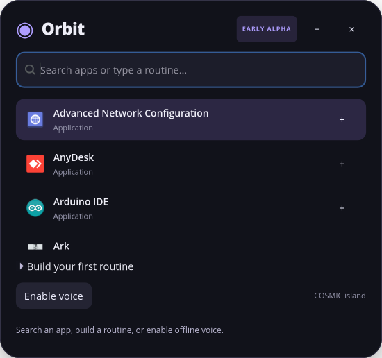

# Orbit

**Your Linux workspace, one phrase away.**

Orbit is an early English voice and keyboard launcher with an expandable island
interface. Search installed desktop applications, group them into a named routine,
and launch them by typing or speaking a phrase such as **Programming**.

This repository is a learning-oriented **alpha**, not a completed v1.
Alpha 2 adds a buildable `.deb` installer and persistent Hey Orbit activation.
No GitHub Release or public download asset has been published by this change.



## Start here

New to Python? Read [the guided Persian walkthrough](docs/START_HERE_FA.md).
The interface and public project documentation are in English.

## Install and activate (alpha 2)

Initial target: **Pop!_OS 24.04, amd64, COSMIC/Wayland**. The package includes the
English speech model, Vosk, and a private Layer Shell runtime. APT manages GTK,
the microphone recorder, and standard Python dependencies. No checkout or venv
is needed by the installed app. APT may need internet for missing system packages.

From the directory containing the built installer:

```bash
sudo apt install './orbit-launcher_0.1.0~alpha2-1_amd64.deb'
```

Open **Orbit** from the application menu and click **Activate Hey Orbit**. The
optional **Start Orbit when I sign in** setting is applied at activation. Orbit
then hides completely. Say **Hey Orbit**, pause, then an app or routine name.
The island opens on the wake event. Escape or **−** hides it again.

Open Orbit from the application menu to return to its controls. **Deactivate Hey
Orbit** stops listening, clears saved activation, and removes Orbit's login entry.
**× / Quit Orbit** stops the current process; saved activation is retained for the
next sign-in. Launching Orbit again reopens the same instance, not another listener.
Microphone failures reveal the controls rather than silently hiding an error.

See [installation and recovery](docs/INSTALL.md) and the
[Persian guide to this development phase](docs/PHASE_INSTALLER_FA.md).

### Development setup: Pop!_OS / Ubuntu 24.04

Install the system-provided GTK bindings and microphone recorder:

```bash
sudo apt install python3-venv python3-pip python3-gi gir1.2-gtk-4.0 pulseaudio-utils
python3 -m venv --system-site-packages .venv
source .venv/bin/activate
python -m pip install -e '.[voice]'
python tools/download_model.py
bash run.sh --doctor
bash run.sh
```

The virtual environment inherits system packages specifically to access the
distribution's PyGObject/GTK bindings. Python voice dependencies stay in `.venv`.
The official English Vosk model is downloaded into `.models`, is not committed,
and is [listed by its publisher as Apache-2.0](https://alphacephei.com/vosk/models).
The downloader records a local digest for reproducibility, not an upstream
checksum verification. Download size is approximately 40 MB.

### Anchored island on COSMIC

GTK4 alone does not provide the desktop layer positioning required by the island.
Orbit uses [gtk4-layer-shell](https://github.com/wmww/gtk4-layer-shell) when available.
The local package cache on the initial Pop!_OS 24.04 development machine did not
include this library. Build the pinned upstream v1.0.4 into `.runtime`:

```bash
sudo apt install build-essential pkg-config meson ninja-build libgtk-4-dev libwayland-dev wayland-protocols gobject-introspection libgirepository1.0-dev
bash tools/build_layer_shell.sh
bash run.sh
```

This source-build helper needs network access and native development packages;
it does not install the library system-wide. `run.sh` sets the local library and
introspection search paths. These development steps are not the eventual
end-user installation experience.

Without a working Layer Shell adapter Orbit clearly labels itself **Window mode**.
You can explicitly use this development fallback with `bash run.sh --window`.
It is not equivalent to a GNOME desktop island.

## Try it

1. Type an installed application name and press Enter. Up/Down selects a result.
2. Use **+** next to two applications. Expand **Build your first routine**.
3. Name it `Programming`, add spoken aliases such as `start coding`, then save.
4. Click **Activate Hey Orbit**. This saves activation and starts the microphone.
5. Say **Hey Orbit**, pause, then **Programming** or **start coding**.
6. With voice active, Escape or **−** hides the island. Reopen Orbit from the app menu.
7. Deactivate to stop persistent activation; **×** quits until the next launch/sign-in.

There is no global keyboard shortcut yet; typing is available by opening Orbit.
Launching a desktop app is a request to the desktop, not proof that its window is
fully ready. Routine launch requests are sent in order, with independent errors;
they do not yet wait for application or service readiness.

The alpha's wake phrase is recognized by the same Vosk engine as commands, rather
than a separate wake-word model. Recognition accuracy, foreign product names,
false activations, microphone failures, and idle CPU/RAM require real-device QA.
Voice commands must exactly and unambiguously match registered phrases. Unknown
speech is not executed as a shell command. Model inference stays on this machine;
audio is not uploaded or saved by Orbit.

## Current scope and compatibility

| Environment / feature | Status |
| --- | --- |
| Python command catalog, configuration, voice activation state | Automated unit tests |
| COSMIC / Wayland island adapter | Short real-session smoke test passed on the initial machine; broader desktop QA pending |
| English speech recognition | Synthetic English audio passed through real Vosk and command activation; real microphone/accent/noise testing pending |
| Hidden activation, wake reveal, recovery, same-instance reopening | GTK integration checks passed with a fake microphone adapter |
| Login startup | Saved preference + background-resume tests; actual logout/login QA pending |
| `.deb` installation | Installed on the original development machine; clean-machine QA pending |
| GNOME / Ubuntu regular window | Development fallback; desktop QA pending |
| GNOME / Wayland native island | Planned separate integration; Layer Shell does not support it |
| Start PostgreSQL as a service | Planned; not an application-launch action in this alpha |
| Open a specific project directory in an editor | Planned action type |
| Search content inside applications | Planned app-specific integration |
| Arbitrary natural-language assistant / chat | Outside initial v1 scope |

See [architecture and compatibility](docs/ARCHITECTURE.md) and
[the roadmap](docs/ROADMAP.md). Actual checks are recorded in
[the validation log](docs/VALIDATION.md). Do not infer GNOME support from Ubuntu being
Debian-based: desktop protocol support is a separate concern.

## Development

```bash
python3 -m unittest discover -s tests -v
python3 -m compileall -q orbit tools
python3 -m orbit --doctor
```

GTK and microphone packages are not required for core unit tests.
`ORBIT_CONFIG_PATH=/absolute/path/routines.json` overrides the normal user
configuration at `$XDG_CONFIG_HOME/orbit/routines.json` (default `~/.config/orbit`).
The speech model path can be overridden with `--model /absolute/path/to/model`.
An activated listener refreshes its vocabulary after a routine is created.

### Known voice limitation

The initial user test reported an IntelliJ command being recognized as a different
phrase. The exact spoken phrase and transcript are still needed for diagnosis.
The registered English alias **open idea** maps to IntelliJ IDEA on the initial
machine and can be tried as a workaround. Arbitrary product-name recognition is
not yet reliable; this alpha is not a completed voice-recognition release.

### Build the installer

```bash
python3 tools/build_deb.py --fetch
```

The explicit `--fetch` populates `.build-assets` from the pinned, verified official
URLs in `packaging/assets.json`. The original model in `.models` is checked against
its pinned tree digest. Later builds can run offline without `--fetch`.
The output is under `dist/`; neither the model, native build cache, nor installer
is committed to Git. Runtime dependencies are declared to APT, not copied from
the developer's `.venv`. See [component provenance](packaging/THIRD_PARTY.md).

## License

Orbit source: [MIT](LICENSE). Dependencies and separately downloaded models retain
their own licenses. No models, recordings, credentials, or personal configuration
belong in this repository. See [GitHub setup](docs/GITHUB_FA.md) before publishing.
